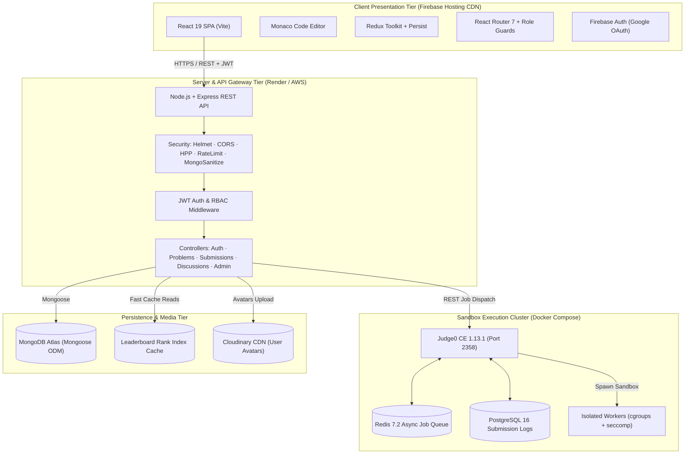
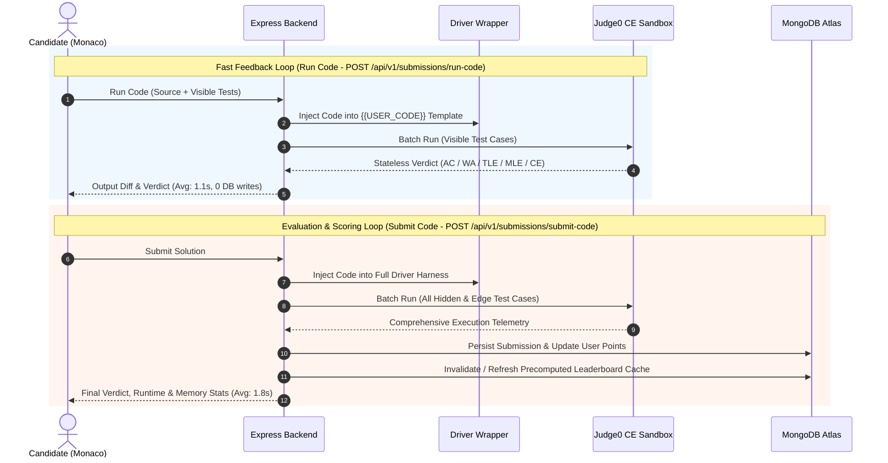
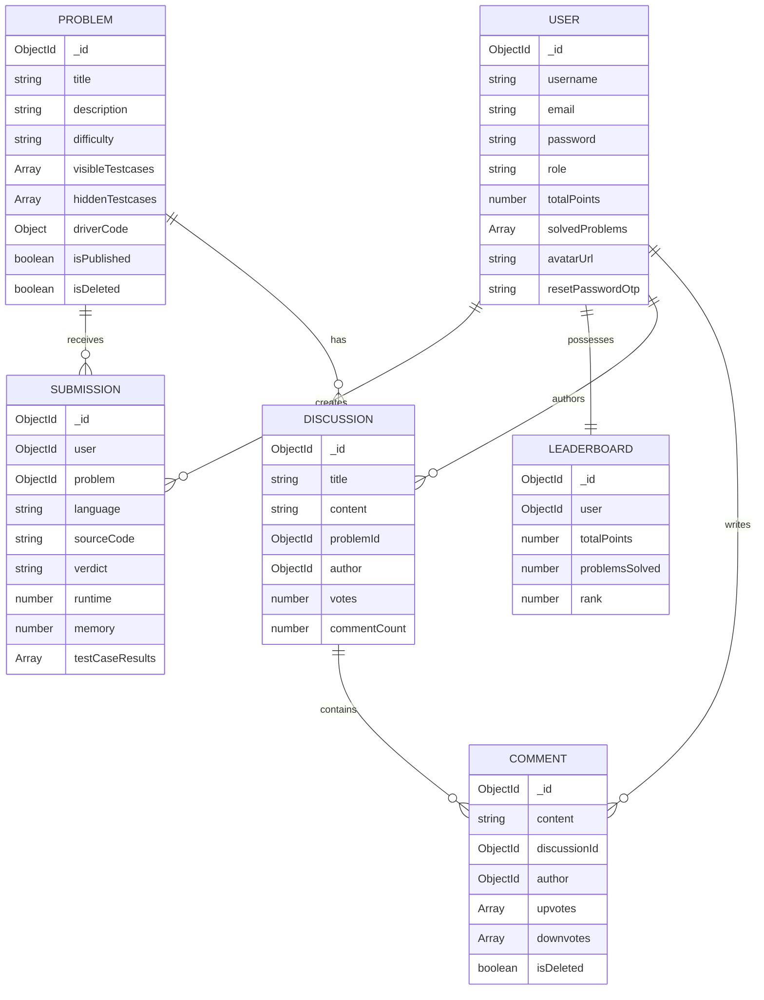
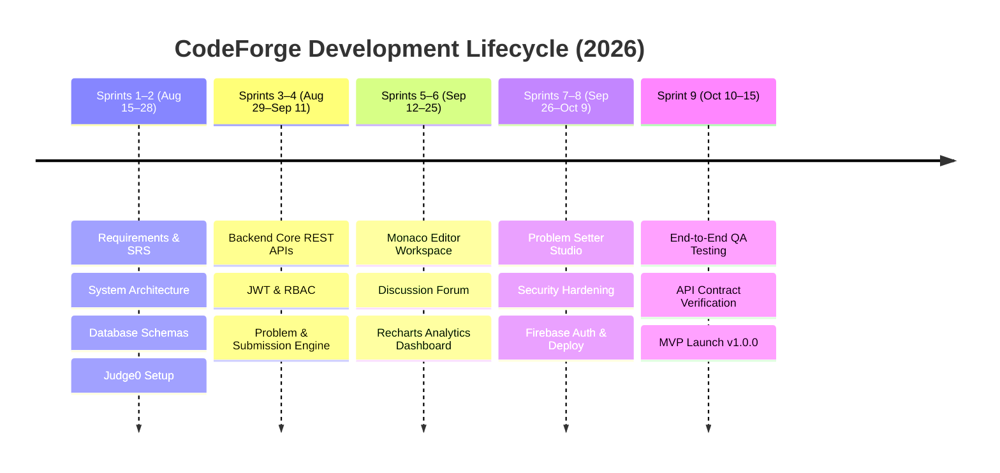

<div align="center">
  <br />
  
  <br />

  <h1>CodeForge</h1>
  
  <p align="center">
    <strong>Competitive Programming Practice Platform & Automated Online Judge</strong><br />
    <em>Software Engineering Project · 2026</em>
  </p>

  <p align="center">
    <a href="https://react.dev/"></a>
    <a href="https://vitejs.dev/"></a>
    <a href="https://nodejs.org/"></a>
    <a href="https://expressjs.com/"></a>
    <a href="https://www.mongodb.com/atlas"></a>
    <a href="https://judge0.com/"></a>
    <a href="https://redis.io/"></a>
    <a href="https://docker.com/"></a>
    <a href="LICENSE"></a>
  </p>

  <p align="center">
    <strong>QA Sign-off Status:</strong> Approved for MVP Launch (QA v1.0.0 · 28/28 API routes · 4 Languages · Responsive Layouts)
  </p>
</div>

<hr />

## 📖 Table of Contents
- [About CodeForge](#-about-codeforge)
- [The Problem CodeForge Solves](#-the-problem-codeforge-solves)
- [Key Features](#-key-features)
- [System Architecture](#-system-architecture)
- [Dual Execution Engine & Solution Wrapper Pattern](#-dual-execution-engine--solution-wrapper-pattern)
- [Data Architecture & Mongoose Schemas](#-data-architecture--mongoose-schemas)
- [Infrastructure, Sandbox & DevOps](#-infrastructure-sandbox--devops)
- [Quality Attributes & Non-Functional Requirements](#-quality-attributes--non-functional-requirements)
- [Testing, Verification & QA Sign-off](#-testing-verification--qa-sign-off)
- [Tech Stack](#-tech-stack)
- [Project Structure](#-project-structure)
- [Getting Started](#-getting-started)
  - [Prerequisites](#prerequisites)
  - [Installation](#installation)
  - [Environment Variables](#environment-variables)
  - [Running the Application](#running-the-application)
- [Project Roadmap & Lifecycle](#-project-roadmap--lifecycle)
- [Project Contributors & Roles](#-project-contributors--roles)
- [Contributing](#-contributing)
- [License](#-license)

---

## 🚀 About CodeForge

**CodeForge** is an enterprise-grade competitive programming practice platform and automated online judge. It provides developers, interview candidates, and students with a secure, friction-free environment to solve algorithmic challenges with sub-second feedback, detailed test-case breakdowns, and global rankings.

Built upon a decoupled multi-tier architecture using React 19, Node.js, Express, MongoDB Atlas, and a containerized **Judge0 CE** cluster, CodeForge ensures isolated execution, preventing untrusted code vulnerabilities while maintaining high concurrency and low latency.

---

## 🎯 The Problem CodeForge Solves

Legacy competitive programming platforms and online judges frequently suffer from systemic bottlenecks that diminish the user experience and introduce severe security vulnerabilities:

1. **Slow Feedback Cycles**: Traditional monolithic judges suffer from job queue congestion and execution delays. CodeForge targets and achieves **< 2 s verdict turnaround** utilizing Redis-backed worker queues.
2. **Security Vulnerabilities**: Executing untrusted user code without strict isolation risks unauthorized system calls, fork bombs, disk exhaustion, and memory leaks. CodeForge implements multi-layer sandboxing using **Docker, Linux cgroups, seccomp syscall filters**, and disabled network access.
3. **Boilerplate Friction**: Standard I/O parsing (e.g., `cin`, `Scanner`, `sys.stdin`) distracts candidates from algorithmic reasoning. CodeForge employs the **Solution Wrapper Pattern**, allowing users to write only core function logic while backend test harnesses handle I/O injection seamlessly.

### Business Metrics & Target Scope

| Objective | Target Metric | Achieved / Implementation |
|---|---|---|
| **Verdict Turnaround** | `< 2 s` | **1.1 s** (Run Code), **1.8 s** (Submit Code) |
| **Language Support** | 4 languages | C++ (GCC 9.2+), Java (OpenJDK 13+), Python (3.8+), JavaScript (Node.js) |
| **Concurrency Target** | `500+` sessions | Stateless REST API + horizontal worker pools |
| **Leaderboard Recalculation** | Sub-second | **< 80 ms** via precomputed indexed cache |

**Target Audience**:
- Competitive programmers & interview candidates
- University educators & students
- Recruiters & technical evaluators

---

## ✨ Key Features

* **Monaco-Powered Code Editor**: Deeply customized in-browser editor (the engine behind VS Code) with syntax highlighting, autocomplete, theme toggles, and output diff viewers.
* **Dual Execution Engine**:
  * **Run Code**: Instant, stateless validation against visible sample test cases without database writes (1.1s avg latency).
  * **Submit Code**: Comprehensive evaluation against hidden and edge test cases with result persistence, runtime/memory telemetry, and score updates (1.8s avg latency).
* **Automated Verdict System**: Generates industry-standard verdicts including Accepted (`AC`), Wrong Answer (`WA`), Time Limit Exceeded (`TLE`), Memory Limit Exceeded (`MLE`), and Compilation Error (`CE`).
* **Solution Wrapper Pattern**: Candidates write clean, modular functions; background drivers automatically inject inputs and parse outputs.
* **Role-Based Access Control (RBAC)**: Secure multi-tier authorization for Candidates, Problem Setters, Moderators, and Administrators.
* **Problem Setter Studio**: Interactive wizard to author challenges, set constraints, generate test drivers, and manage visible/hidden test cases.
* **Interactive Analytics & Dashboard**: Visual progress tracking, solved counts by difficulty, language distribution, and submission history powered by Recharts.
* **Dynamic Global Leaderboard**: High-speed ranking system with precomputed rank indexing, streak counters, and instant cache updates upon first Accepted solution.
* **Community Forum & Discussion**: Threaded problem discussions, upvoting/downvoting mechanism, and moderation tooling with soft deletion.
* **Plagiarism Detection**: Automated token-based similarity detection module (FR009) to protect contest and submission integrity.

---

## 🏗️ System Architecture

CodeForge is engineered as a decoupled, multi-tier distributed system:



---

## ⚡ Dual Execution Engine & Solution Wrapper Pattern

CodeForge differentiates developer iteration from formal submission evaluation through its **Dual Execution Engine**:



### The Solution Wrapper Pattern

Rather than requiring standard I/O parsing boilerplate from users, CodeForge wraps user logic in language-specific test drivers:

1. **User writes core logic only**:
   ```javascript
   function twoSum(nums, target) {
       const map = new Map();
       for (let i = 0; i < nums.length; i++) {
           const complement = target - nums[i];
           if (map.has(complement)) return [map.get(complement), i];
           map.set(nums[i], i);
       }
       return [];
   }
   ```
2. **Backend injects user solution into driver harness**:
   ```javascript
   // {{USER_CODE}} injected here
   const fs = require('fs');
   const input = JSON.parse(fs.readFileSync(0, 'utf-8'));
   const result = twoSum(input.nums, input.target);
   console.log(JSON.stringify(result));
   ```
3. **Security measure**: Hidden test cases and driver harness templates are marked `select: false` in Mongoose schemas to prevent client inspection.

---

## 📊 Data Architecture & Mongoose Schemas

The database schema is modeled to prioritize fast reads, strict referential integrity, and efficient indexing:



---

## 🔒 Infrastructure, Sandbox & DevOps

CodeForge enforces strict resource containment to execute untrusted code safely:

### Sandbox Constraints (Judge0 CE 1.13.1)
* **RAM Cap**: `128 MB` maximum memory allocation.
* **CPU Quota**: `2.0 s` execution timeout before triggering `TLE`.
* **File System**: Max `4 KB` file write quota to avoid disk fill attacks.
* **Networking**: Zero outbound network access inside worker containers.
* **System Calls**: Restricted via Linux `cgroups` and `seccomp` system call filtering.

### API Gateway Hardening
* **Helmet**: Configures strict HTTP security headers (CSP, HSTS, X-Frame-Options).
* **CORS**: Whitelisted origins with credential support (`http://localhost:5173` for dev, Firebase CDN in prod).
* **Rate Limiting**: Enforced via `express-rate-limit` (100 requests per 15 minutes on auth endpoints).
* **NoSQL Injection Guard**: Input sanitization via `express-mongo-sanitize`.
* **Parameter Pollution Protection**: `hpp` middleware.
* **Password Hashing**: `bcryptjs` with 10 salt rounds.

---

## 📈 Quality Attributes & Non-Functional Requirements

| # | Attribute | Requirement Specification |
|---|---|---|
| **NFR001** | **Performance** | Sub-2.0 second verdict latency via Redis batch queues; leaderboard recalculation under 80 ms. |
| **NFR002** | **Concurrency** | 500+ simultaneous practice sessions via stateless API instances and worker pools. |
| **NFR003** | **Secure Execution** | 128 MB RAM, 2.0s CPU cap, disabled network, cgroups & seccomp syscall filtering. |
| **NFR004** | **Data Security** | 10-round bcrypt password hashing, signed JWT in HTTP-only cookies, Helmet, and NoSQL sanitization. |
| **NFR005** | **Availability** | 99% uptime target with auto-restarting containers, database connection retries, and CDN failover. |
| **NFR006** | **Scalability** | Horizontal scaling for API instances (Render / AWS) and decoupled execution nodes. |

---

## 🧪 Testing, Verification & QA Sign-off

CodeForge has passed rigorous end-to-end verification and quality assurance:

* **Jest Unit Tests**: Complete unit suite validating JWT generation/verification, schema constraints, and multi-test verdict aggregation.
* **Postman API Contract Tests**: 28 out of 28 endpoints verified across Auth, Problems, Submissions, Users, Discussions, and Admin modules with a **100% pass rate**.
* **Sandbox Boundary Tests**:
  * Infinite loops correctly trigger `Time Limit Exceeded (TLE)`.
  * Out-of-bounds memory allocations reliably trigger `Memory Limit Exceeded (MLE)`.
  * Invalid syntax properly extracts compilation stdout/stderr into `Compilation Error (CE)`.
* **Security Audit**: Verified protection against NoSQL injection, timing attacks on passwords, expired JWT handling, and RBAC privilege escalation.
* **Measured Latency Benchmarks**:
  * **Run Code Average Latency**: `1.1 s` (Passing SLA `< 2.0 s`)
  * **Submit Code Average Latency**: `1.8 s` (Passing SLA `< 2.0 s`)
  * **Leaderboard Recalculation**: `< 80 ms`
* **Sign-Off Verdict**: **APPROVED FOR PRODUCTION MVP LAUNCH (v1.0.0)**.

---

## 🛠️ Tech Stack

<details open>
<summary><strong>Frontend (Client)</strong></summary>

* **Framework & Build**: [React 19](https://react.dev/), [Vite](https://vitejs.dev/)
* **Styling & Icons**: [Tailwind CSS 4](https://tailwindcss.com/), [React Icons](https://react-icons.github.io/react-icons/)
* **Code Editor**: [Monaco Editor (`@monaco-editor/react`)](https://github.com/suren-atoyan/monaco-react)
* **State Management**: [Redux Toolkit](https://redux-toolkit.js.org/), [Redux Persist](https://github.com/rt2zz/redux-persist)
* **Routing**: [React Router 7](https://reactrouter.com/) (with role-aware protected routes)
* **Forms & Validation**: [React Hook Form](https://react-hook-form.com/) + [Zod](https://zod.dev/)
* **Visualizations & Charts**: [Recharts](https://recharts.org/)
* **Third-Party Services**: [Firebase Auth](https://firebase.google.com/) (Google OAuth), Axios, React Toastify

</details>

<details open>
<summary><strong>Backend (Server)</strong></summary>

* **Runtime & Framework**: [Node.js](https://nodejs.org/), [Express.js 5](https://expressjs.com/)
* **Database & ODM**: [MongoDB Atlas](https://www.mongodb.com/atlas), [Mongoose 9](https://mongoosejs.com/)
* **Authentication**: JSON Web Tokens (`jsonwebtoken`), `bcryptjs`
* **Security & Utility**: `helmet`, `cors`, `hpp`, `express-rate-limit`, `cookie-parser`, `morgan`
* **Media & Notifications**: [Cloudinary](https://cloudinary.com/), [Nodemailer](https://nodemailer.com/)

</details>

<details open>
<summary><strong>Infrastructure & Sandbox</strong></summary>

* **Execution Engine**: [Judge0 CE 1.13.1](https://judge0.com/)
* **Queue & Cache**: [Redis 7.2](https://redis.io/)
* **Submission Store**: [PostgreSQL 16](https://www.postgresql.org/)
* **Orchestration**: Docker & Docker Compose
* **Isolation**: Linux cgroups, seccomp filters

</details>

---

## 📂 Project Structure

```text
CodeForge/
├── client/                     # React 19 + Vite frontend
│   ├── src/
│   │   ├── components/         # Reusable UI components (Navbar, Footer, Modals)
│   │   ├── pages/              # Views (Home, ProblemSet, Workspace, Dashboard, Leaderboard, Admin)
│   │   ├── redux/              # Redux slices (authSlice, problemSlice) & store
│   │   ├── services/           # Axios API service instances
│   │   └── utils/              # Helper utilities & language configurations
│   ├── public/                 # Static assets & icons
│   ├── package.json            # Client dependencies
│   └── vite.config.js          # Vite configuration
│
├── server/                     # Express.js REST API backend
│   ├── src/
│   │   ├── config/             # Database connection & third-party setup
│   │   ├── controllers/        # Business logic (auth, problem, submission, user, admin)
│   │   ├── middleware/         # Auth verification, RBAC guards, multer upload
│   │   ├── models/             # Mongoose schemas (User, Problem, Submission, Leaderboard)
│   │   ├── routes/             # REST route definitions (/api/v1/...)
│   │   ├── services/           # Judge0 code execution service & driver wrappers
│   │   └── utils/              # Email delivery & token utilities
│   ├── server.js               # Express application entrypoint
│   ├── .env.example            # Backend environment template
│   └── package.json            # Server dependencies
│
├── infrastructure/             # Container orchestration
│   └── judge0/                 # Docker Compose stack for Judge0, Redis & Postgres
│
├── documentation/              # Engineering specifications & reports
│   ├── SRS.md                  # Software Requirements Specification
│   ├── architecture.md         # System Architecture & Component Mapping
│   ├── execution_engine_spec.md# Judge0 Sandbox & Isolation Spec
│   ├── security_audit_report.md# Security Hardening & Penetration Audit
│   ├── qa_signoff_report.md    # QA Smoke Test & Contract Verification
│   └── user_stories.md         # User Personas & Acceptance Criteria
│
└── README.md                   # Project documentation
```

---

## 🏁 Getting Started

Follow these steps to set up and run CodeForge locally.

### Prerequisites

* **Node.js**: v18.0.0 or higher
* **MongoDB**: A running local MongoDB instance or a [MongoDB Atlas](https://www.mongodb.com/atlas) URI
* **Docker & Docker Compose**: Required for running the local Judge0 execution sandbox
* **Git**: For source version control

### Installation

1. **Clone the repository**:
   ```bash
   git clone https://github.com/Jeet0105/CodeForge.git
   cd CodeForge
   ```

2. **Install Server Dependencies**:
   ```bash
   cd server
   npm install
   ```

3. **Install Client Dependencies**:
   ```bash
   cd ../client
   npm install
   ```

4. **Spin Up the Judge0 Sandbox Infrastructure**:
   ```bash
   cd ../infrastructure/judge0
   docker-compose up -d
   ```
   *Judge0 will start listening on `http://localhost:2358`.*

### Environment Variables

Configure `.env` files in both `server/` and `client/` directories:

#### Backend Configuration (`server/.env`)
```env
PORT=5000
NODE_ENV=development
MONGO_URI=mongodb+srv://<username>:<password>@cluster.mongodb.net/codeforge?retryWrites=true&w=majority
JWT_SECRET=your_super_secret_jwt_key_here

# Judge0 Execution Service
JUDGE0_API_URL=http://localhost:2358

# Mail Configuration (Optional for password resets)
SMTP_HOST=smtp.mailtrap.io
SMTP_PORT=2525
SMTP_EMAIL=your_smtp_email
SMTP_PASSWORD=your_smtp_password
FROM_EMAIL=support@codeforge.com
FROM_NAME=CodeForge Support

# Cloudinary (Optional for avatar uploads)
CLOUDINARY_CLOUD_NAME=your_cloud_name
CLOUDINARY_API_KEY=your_api_key
CLOUDINARY_API_SECRET=your_api_secret
CLOUDINARY_UPLOAD_PRESET=codeforge_avatars
```

#### Frontend Configuration (`client/.env`)
```env
VITE_API_BASE_URL=http://localhost:5000/api/v1
VITE_FIREBASE_API_KEY=your_firebase_api_key
VITE_FIREBASE_AUTH_DOMAIN=your_project.firebaseapp.com
VITE_FIREBASE_PROJECT_ID=your_firebase_project_id
VITE_FIREBASE_STORAGE_BUCKET=your_project.appspot.com
VITE_FIREBASE_MESSAGING_SENDER_ID=your_sender_id
VITE_FIREBASE_APP_ID=your_app_id
```

### Running the Application

Open two terminal windows:

**Terminal 1 — Backend Server**:
```bash
cd server
npm run dev
```
*The server will start on `http://localhost:5000`.*

**Terminal 2 — Frontend Client**:
```bash
cd client
npm run dev
```
*The client will start on `http://localhost:5173`.*

---

## 🗺️ Project Roadmap & Lifecycle

The project followed an agile methodology spanning 9 sprints, 72 commits, and 8 contributors:



### Future Enhancements (Post-MVP)
* **AI Hints**: LLM-powered context-aware algorithmic hints and Big-O complexity analysis.
* **1v1 Coding Contests**: Real-time multiplayer speed coding duels over WebSockets.
* **AST Plagiarism Detection**: Abstract Syntax Tree similarity matching to catch identifier renaming and restructuring.
* **Mobile Companion App**: Cross-platform React Native client for problem review, discussions, and leaderboard tracking.

---

## 👥 Project Contributors & Roles

| Contributor | Role | Core Contributions |
|---|---|---|
| **Jeet Maheshwari** | **Project Lead & Architect** | System design, SRS & SDD authorship, dual execution engine architecture, deployment & CI/CD pipeline. |
| **Kenil Dhola** | **Auth, RBAC & Users** | JWT authentication, bcrypt password security, role-based access control, user management APIs. |
| **Harshvardhan Sarvaiya** | **Judge0 Infra & Sandbox** | Judge0 Docker Compose stack, Redis queue & isolated worker orchestration, execution limit enforcement. |
| **Vivek Savaliya** | **Problems & Submissions** | Problem creation workflows, visible/hidden test case models, Run Code & Submit APIs, verdict aggregation. |
| **Harsh Abhichandani** | **Discussions & Plagiarism** | Threaded discussion forums, comment voting & moderation, code plagiarism detection module. |
| **Prit Tilala** | **Vite Client, Redux & Auth UI** | React 19 + Vite setup, Redux Toolkit state architecture, route guards, login/registration UI, Google OAuth. |
| **Shashwat** | **Monaco Editor & Workspace** | Monaco code editor integration, run console & output diff viewer, workspace & setter studio UI. |
| **Hardik** | **Dashboards, Leaderboard & QA** | Recharts analytics dashboards, precomputed leaderboard cache, Jest unit tests, Postman API contracts & security audit. |

---

## 🤝 Contributing

Contributions are welcomed! To contribute to CodeForge:

1. Fork the repository
2. Create your feature branch (`git checkout -b feature/AmazingFeature`)
3. Commit your changes (`git commit -m 'feat: Add some AmazingFeature'`)
4. Push to the branch (`git push origin feature/AmazingFeature`)
5. Open a Pull Request

---

## 📄 License

Distributed under the **ISC License**. See [`LICENSE`](LICENSE) for further details.

---

<div align="center">
  Crafted with precision by the <strong>CodeForge Team</strong> · 2026
</div>
