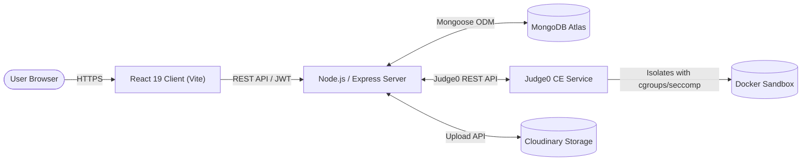

# CodeForge System Architecture

## Architecture Overview
CodeForge is built on a decoupled, microservices-friendly architecture:
- **Frontend Client**: React 19, Vite, Tailwind CSS 4, Monaco Editor, Redux Toolkit
- **Backend API**: Node.js, Express.js REST API
- **Primary Database**: MongoDB Atlas (Cloud NoSQL)
- **Execution Sandbox**: Judge0 CE API running in containerized Docker environment
- **Media Storage**: Cloudinary for user profile pictures
- **Hosting & CDN**: Firebase Hosting for client, Render/AWS for backend

### Revision Log
- 2026-08-19: Architecture specifications drafted by Harsh Abhichandani.

- 2026-08-19: Forum and plagiarism flow documented by Harsh Abhichandani.
